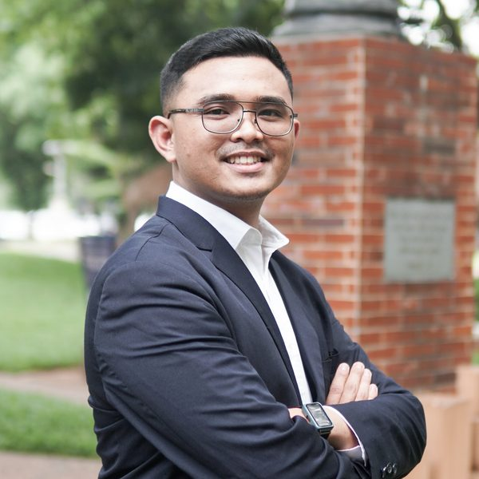

<section class="hero">
  
  

    <h1>Feliks Victor Parningotan Samosir</h1>
    

      Dosen Tetap Informatika 
      Fakultas AI dan Data Science, Universitas Pelita Harapan
    

    
  

</section>

## Tentang saya

Saya dosen tetap di Fakultas AI dan Data Science, Universitas Pelita Harapan (UPH), Tangerang. Riset saya mempelajari apa yang patah ketika sistem NLP dan machine learning mainstream bertemu dengan konteks Indonesia yang kurang terwakili, terutama bahasa lokal low-resource seperti Batak Toba. Saat ini saya memimpin riset Batak Toba tahap kedua yang didanai hibah internal UPH.

<dl class="about-facts">
  <dt>Riset</dt>
  <dd>Empat area: NLP spesifik domain untuk teks Indonesia khusus, bahasa-bahasa lokal Indonesia low-resource, bias dan fairness pada dataset serta model NLP Indonesia, dan applied machine learning untuk data dunia nyata. Riset Batak Toba tahap pertama membangun <a href="https://github.com/FeliksMakarios/batak-toba-korpus">korpus multi-domain Batak Toba</a>; tahap kedua yang sedang berjalan menyusun pedoman anotasi Universal Dependencies untuk Batak Toba. Pada 2026 saya mengikuti program SEACrowd Apprentice dan ikut mengembangkan <a href="https://github.com/cppmai1103/CoRaL">CoRaL</a>, framework kurasi data multi-dimensi untuk korpus pelatihan bahasa low-resource, bersama kolaborator di <a href="https://seacrowd.org/apprenticeship">SEACrowd</a>. Rinciannya ada di halaman <a href="/id/research/">Riset</a>.</dd>

  <dt>Pengajaran</dt>
  <dd>Semester ini saya mengampu Kecerdasan Komputasional, Pengantar Pemelajaran Mesin, dan Pemrosesan Bahasa Alami. Sejak 2023 saya mengampu mata kuliah lintas kurikulum Informatika S1. RPS dan materi kuliahnya dapat dilihat di halaman <a href="/id/teaching/">Pengajaran</a>.
    

Semua mata kuliah sejak 2023

      
<strong>Mata kuliah dasar:</strong> Pengantar Informatika &amp; Komputasi, Organisasi &amp; Arsitektur Komputer, Pemodelan Berorientasi Objek, Sistem Basis Data, dan Pengembangan Piranti Lunak.

      
<strong>Data science dan kecerdasan buatan:</strong> Pengantar Data Science, Pengantar Kecerdasan Buatan, Pengantar Pemelajaran Mesin, Pemelajaran Mesin Lanjut, Studio Pengembangan Aplikasi Data Science, dan Pemrosesan Bahasa Alami.

    

  </dd>

  <dt>Bimbingan</dt>
  <dd>Saya membimbing riset S1 dengan fokus utama NLP, ditambah sebagian kecil proyek applied machine learning. Topik skripsi terkini mulai dari analisis sentimen berbasis aspek pada e-commerce Indonesia, pencarian semantik untuk korpus teologi, audit bias dataset, automatic speech recognition untuk Bahasa Jawa, sampai metode ensemble berbasis tree untuk data lingkungan. Daftar lengkapnya ada di halaman <a href="/id/students/">Mahasiswa</a>.</dd>

  <dt>Pendidikan</dt>
  <dd><strong>M.Kom.</strong>, <a href="https://www.maranatha.edu/">Universitas Kristen Maranatha</a>, Bandung, 2022. Tesis tentang BESKlus, model extractive summarization berbasis BERT dengan K-Means clustering untuk artikel ilmiah, dengan bimbingan <a href="https://smartech.maranatha.edu/dosen/hapnes-toba/" target="_blank" rel="noopener">Hapnes Toba</a> dan <a href="https://smartech.maranatha.edu/dosen/mewati-ayub/" target="_blank" rel="noopener">Mewati Ayub</a>. 
  <strong>S.Pd. Teknik Informatika</strong>, <a href="https://um.ac.id/">Universitas Negeri Malang</a>, 2018, dengan bimbingan <a href="https://pakar.um.ac.id/Data/Peneliti/u=7acd40b9-08f6-42ad-b72c-89b05c5dd868" target="_blank" rel="noopener">Heru Wahyu Herwanto</a> dan <a href="https://pakar.um.ac.id/Data/Peneliti/u=7aa0937c-a5bd-4d63-9320-02680342670a" target="_blank" rel="noopener">Muhammad Jauharul Fuady</a>.</dd>

  <dt>Jabatan</dt>
  <dd>Ketua Program Studi S1 Informatika UPH, April 2024 sampai Juli 2026.</dd>
</dl>

## Kabar terbaru


  date_str is "YYYY-MM" or "YYYY-MM-DD". A full date saved without quotes is read
  by YAML as a date object, so turn every value into text (append: "") before
  sorting; mixing dates and strings in `sort` would break the build.











{{ year_group.name }}{{ year_group.items.size }} entri
<ul class="news-list"><li class="news-item">
<strong>{{ item.title.id }}</strong>
{{ item.text.id }}

</li></ul>




Belum ada kabar terbaru.



## Mencari dosen pembimbing TA?

Kalau kamu mahasiswa Informatika UPH yang tertarik di NLP atau applied ML, silakan lihat <a href="/id/research/">bidang riset saya</a>.
Tiap halaman detail bidang mencantumkan topik TA yang terbuka; silakan email saya untuk diskusi ide.



  
<strong>Sedang terbuka untuk:</strong> bimbingan skripsi di keempat bidang riset saya, dengan
  {{ open_topics }} topik yang masih terbuka saat ini. Contohnya NLP untuk bahasa low-resource apa pun, termasuk
  bahasa daerah Indonesia seperti Batak Toba, Jawa, atau Sunda (misalnya anotasi Universal Dependencies, evaluasi LLM,
  dan transfer lintas bahasa), NLP ucapan dan multimodal, bias pada model bahasa Indonesia,
  serta machine learning untuk data kesehatan dan lingkungan. Dasar Python dan Hugging Face Transformers akan
  sangat membantu.

